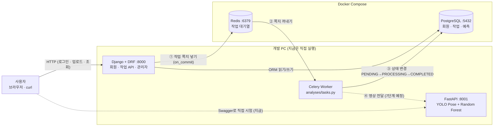
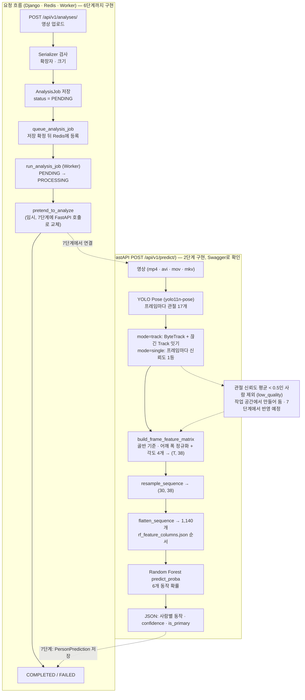
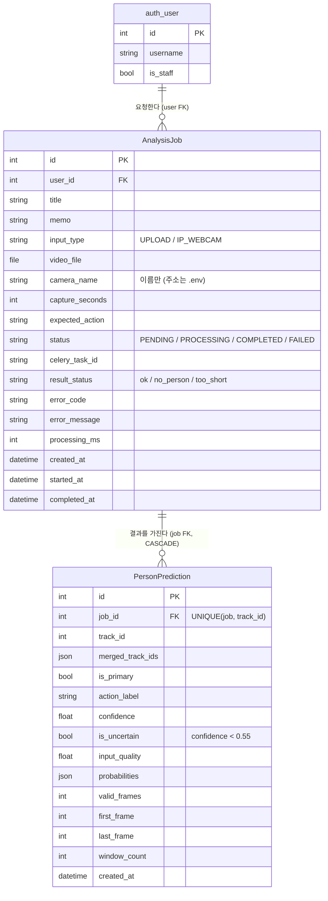

# vision_action_platform

영상 속 사람의 동작 6가지를 알아보는 웹 서비스다. 교과10 자율 프로젝트(9~10일차) 결과물이다.
6일차에 학습한 Random Forest 모델을 **새로 학습하지 않고** 그대로 불러와, Django·FastAPI·Celery로 서비스에 연결한다.

> **진행 상황 (2026-11-25):** 1~6단계 완료. 7단계(Worker → FastAPI 연결)부터 남음.
> 그래서 지금은 웹에서 맡긴 작업이 `COMPLETED`까지 가지만 사람별 예측은 아직 저장되지 않는다. 추론은 FastAPI Swagger에서 따로 확인한다.

## 알아보는 동작

| ID | 라벨 | 동작 |
|---|---|---|
| A001 | `bend_return` | 허리를 굽혔다 펴기 |
| A002 | `leg_raise_lower` | 한쪽 다리를 들었다 내리기 |
| A003 | `walk_turn_walk` | 걷다가 방향을 바꿔 다시 걷기 |
| A004 | `drink_return` | 음료를 마시고 돌아오기 |
| A005 | `sit_stand` | 앉았다 일어나기 |
| A006 | `wave` | 손 흔들기 |

## 기술 스택

| 구성 | 맡은 일 | 포트 |
|---|---|---|
| Django 6.1 + DRF 3.18 | 회원, 분석 작업 API, 관리자 페이지, DB 저장 | 8000 |
| Celery 5.7 Worker | 오래 걸리는 분석을 웹 서버 밖에서 처리 | - |
| Redis 8 | Celery 작업 대기열 (브로커) | 6379 |
| PostgreSQL 17 | 회원·작업·사람별 예측 영구 저장 | 5432 |
| FastAPI | YOLO Pose(yolo11n-pose) + Random Forest 추론, JSON 반환 | 8001 |

## 1. 아키텍처



- 사람이 들어오는 곳은 Django(8000) 하나다. FastAPI는 Worker만 부르는 안쪽 서비스다 (지금은 시험용으로 Swagger에서 직접 부름).
- FastAPI는 DB에 접근하지 않는다. 결과 저장은 Django ORM(Worker)이 맡는다.
- 점선은 아직 연결하지 않은 길이다.

## 2. 데이터 파이프라인



- 학습 때와 같은 함수(`ai_service/src/sequence_utils.py`)로 숫자를 만든다. 학습 때와 순서·방식이 하나라도 다르면 오류 없이 틀린 답이 나오기 때문이다.
- 모델 입력은 1,140개 = 30칸(시간) × 38개(정규화 좌표 34 + 관절 각도 4).
- `confidence`(1위 동작 확률)가 0.55 미만이면 `is_uncertain`으로 표시한다.
- 점선 상자(관절 신뢰도가 낮은 사람 걸러내기)는 아직 이 저장소에 없다. 7단계에서 넣고 확인한다.

## 3. ERD



- 회원(Django 기본 `auth_user`) 1 : N 분석 작업 1 : N 사람별 예측.
- 분석 작업을 지우면 그 사람별 예측도 함께 지워진다 (CASCADE). 한 작업 안에서 같은 `track_id`는 한 번만 저장된다.
- 카메라 주소는 DB에 넣지 않고 `.env`에만 둔다. DB에는 카메라 이름만 남는다.

## 폴더 구조 (지금 있는 것)

```text
vision_action_platform/
├── backend/            Django·DRF와 Celery Worker가 함께 쓰는 코드
│   ├── config/         설정 · URL · celery.py
│   ├── accounts/       회원가입 · 내 정보
│   ├── analyses/       모델 · API · tasks.py(Worker 작업) · 테스트
│   └── templates/
├── ai_service/         FastAPI 추론 서비스
│   ├── models/         rf_action_baseline.joblib · rf_feature_columns.json · rf_training_info.json · yolo11n-pose.pt
│   ├── routers/        predictions.py
│   ├── services/       model_loader.py · pose_pipeline.py · action_inference.py
│   └── src/            6~8일차 실습 코드 (복사본)
├── compose.yaml        지금은 postgres · redis (11단계에서 5개 서비스로)
└── .env.example        필요한 설정 이름과 예시 값
```

## 실행 방법 (Windows, 지금 단계)

가상환경이 두 개다: `backend\.venv`(Django·Worker), `ai_service\.venv`(FastAPI).
**설치할 때는 `--python`으로 설치할 곳을 꼭 적는다.** (터미널에 다른 가상환경이 켜져 있으면 그쪽에 설치되기 때문)

```powershell
# 0. 설정 파일
copy .env.example .env      # 값 채우기

# 1. 패키지 설치
cd backend
uv pip install -r requirements.txt --python .venv\Scripts\python.exe
cd ..\ai_service
uv pip install -r requirements.txt --python .venv\Scripts\python.exe

# 2. DB·대기열 켜기 (프로젝트 맨 위 폴더)
docker compose up -d postgres redis

# 3. 처음 한 번: 테이블 만들기 + 관리자 계정
cd backend
.venv\Scripts\python manage.py migrate
.venv\Scripts\python manage.py createsuperuser

# 4. 각각 새 터미널에서
.venv\Scripts\celery -A config worker --loglevel=info --pool=solo   # backend (Windows는 --pool=solo 필요)
.venv\Scripts\python manage.py runserver                            # backend
.venv\Scripts\python -m uvicorn main:app --port 8001                # ai_service
```

## 주요 주소 (자세한 내용은 아래 API 명세)

| 주소 | 내용 |
|---|---|
| http://localhost:8000/accounts/signup/ · /accounts/login/ | 회원가입 · 로그인 |
| http://localhost:8000/api/v1/analyses/ | 내 분석 작업 목록 · 새 작업 (POST) |
| http://localhost:8000/api/v1/analyses/{id}/ | 작업 상태 · 결과 조회, 제목·메모 수정, 삭제 |
| http://localhost:8000/admin/ | 관리자 페이지 (전체 작업) |
| http://localhost:8001/docs | FastAPI Swagger (`POST /api/v1/predict/?mode=track\|single`) |

## API 명세

### 공통 규칙 (Django API)

- 주소 앞부분: `http://localhost:8000/api/v1/`
- **로그인 필요.** 세션 로그인(브라우저) 또는 Basic 인증(curl `-u 아이디`)을 쓴다. 로그인 없이 부르면 `403`이다. (세션 방식을 먼저 확인하도록 설정해서 `401`이 아니라 `403`이 나온다)
- 일반 회원은 **자기 작업만** 보고 고치고 지운다. 남의 작업 번호로 부르면 `404`다 (`403`이 아닌 이유: 그 번호의 작업이 있다는 사실도 알려 주지 않기 위해, T07).
- 관리자(`is_staff`)는 모든 작업을 본다.
- 목록은 한 쪽에 20개씩 나눠서 준다 (`?page=2`).
- 작업 전체를 바꾸는 `PUT`은 열지 않았다 (`405`).

| 메서드 | 주소 | 하는 일 | 성공 | 주요 실패 |
|---|---|---|---|---|
| GET | `/api/v1/analyses/` | 내 작업 목록 (새 것부터) | 200 | 403 |
| POST | `/api/v1/analyses/` | 새 분석 작업 맡기기 | 201 | 400, 403 |
| GET | `/api/v1/analyses/{id}/` | 작업 한 건: 상태 + 사람별 예측 | 200 | 403, 404 |
| PATCH | `/api/v1/analyses/{id}/` | 제목·메모 고치기 | 200 | 400, 403, 404 |
| DELETE | `/api/v1/analyses/{id}/` | 작업 지우기 (사람별 예측·업로드 영상도 함께) | 204 | 403, 404 |

#### POST `/api/v1/analyses/` — 작업 맡기기

`multipart/form-data`로 보낸다 (영상 파일이 있으므로).

| 칸 | 필수 | 설명 |
|---|---|---|
| `input_type` | 필수 | `UPLOAD` 또는 `IP_WEBCAM` |
| `video_file` | `UPLOAD`일 때 필수 | `.mp4` `.avi` `.mov` `.mkv`, 빈 파일 불가, 최대 `UPLOAD_MAX_MB`(기본 100MB). `IP_WEBCAM`일 때는 넣으면 안 됨 |
| `camera_name` | `IP_WEBCAM`일 때 필수 | `.env`의 `IP_WEBCAM_CAMERAS`에 등록된 **이름**만 (주소는 받지 않음). `UPLOAD`일 때는 넣으면 안 됨 |
| `capture_seconds` | 선택 | `IP_WEBCAM` 수집 시간, 5~10초 (기본 8) |
| `expected_action` | 선택 | 사용자가 하려는 동작 (6개 라벨 중 하나). 정답이 아니라 참고용 |
| `title`, `memo` | 선택 | 제목 · 메모 |

```bash
curl.exe -u edmin -F "input_type=UPLOAD" -F "video_file=@S01_A002_T01.mp4" -F "expected_action=leg_raise_lower" http://localhost:8000/api/v1/analyses/
```

- 저장 즉시 `201`로 답한다 (분석이 끝날 때까지 기다리지 않음, T05). 응답의 `status`는 `PENDING`, `celery_task_id`가 채워져 있다.
- 작업 대기열(Redis)에 연결하지 못하면 그래도 `201`이지만 `status: FAILED`, `error_code: QUEUE_UNAVAILABLE`로 저장된다.
- 입력이 규칙에 맞지 않으면 `400`과 함께 어느 칸이 왜 틀렸는지 알려 준다. 예: `{"video_file": ["영상 업로드 방식은 영상 파일이 필요합니다."]}`
- 현재(6단계) IP Webcam 작업은 저장·대기열 등록까지만 되고, 실제 카메라 수집은 8단계에서 붙인다.

#### GET `/api/v1/analyses/{id}/` — 상태와 결과 보기

브라우저는 이 주소를 몇 초마다 다시 불러 상태를 확인한다 (9단계 화면).

```json
{
  "id": 5,
  "user": "edmin",
  "title": "",
  "memo": "",
  "input_type": "UPLOAD",
  "video_file": "http://127.0.0.1:8000/media/uploads/2026/11/25/S01_A002_T01.mp4",
  "camera_name": "",
  "capture_seconds": null,
  "expected_action": "leg_raise_lower",
  "status": "COMPLETED",
  "status_display": "완료",
  "result_status": "",
  "error_code": "",
  "error_message": "",
  "processing_ms": null,
  "celery_task_id": "574e75c1-d708-4031-b1da-e47b0d2bf308",
  "created_at": "2026-11-25T11:11:13.982654+09:00",
  "started_at": "2026-11-25T11:11:13.989439+09:00",
  "completed_at": "2026-11-25T11:11:17.000803+09:00",
  "predictions": []
}
```

| 칸 | 뜻 |
|---|---|
| `status` | `PENDING`(대기) → `PROCESSING`(처리 중) → `COMPLETED`(완료) 또는 `FAILED`(실패) |
| `result_status` | FastAPI가 알려 준 결과 구분 `ok` · `no_person` · `too_short` (7단계부터 채워짐) |
| `error_code` | 실패 이유. 지금 있는 값: `QUEUE_UNAVAILABLE`(대기열 연결 실패), `WORKER_ERROR`(Worker 처리 중 오류) |
| `predictions` | 사람별 예측 목록 (7단계부터 채워짐). 한 사람 = `track_id`, `is_primary`, `merged_track_ids`, `action_label`, `confidence`, `is_uncertain`, `input_quality`, `valid_frames`, `first_frame`, `last_frame`, `window_count`, `probabilities` |

#### PATCH `/api/v1/analyses/{id}/` — 제목·메모 고치기

`title`, `memo`만 받는다. 다른 칸(`status`, `predictions` 등)을 보내면 `400` (`"이 칸은 고칠 수 없습니다."`). 상태와 결과는 시스템만 바꾼다.

---

### FastAPI 추론 API (안쪽 서비스)

- 주소 앞부분: `http://localhost:8001`. 로그인 없음 — 바깥에 열지 않고 Worker만 부르는 서비스이기 때문이다.
- DB에 아무것도 저장하지 않는다. 결과 JSON을 돌려줄 뿐이다.
- Swagger(시험 화면): `http://localhost:8001/docs`

| 메서드 | 주소 | 하는 일 | 성공 | 실패 |
|---|---|---|---|---|
| GET | `/health` | 살아 있는지, 모델이 준비됐는지 | 200 | — |
| POST | `/api/v1/predict/?mode=track` | 영상 → 사람별 동작 예측 | 200 | 422, 503 |

#### GET `/health`

```json
{
  "status": "ok",
  "model_ready": true,
  "classes": ["bend_return", "drink_return", "leg_raise_lower", "sit_stand", "walk_turn_walk", "wave"],
  "feature_count": 1140,
  "sequence_steps": 30,
  "min_valid_frames": 10,
  "device": "cpu"
}
```

모델을 불러오는 중이면 `{"status": "starting", "model_ready": false}`.

#### POST `/api/v1/predict/`

- 요청: `multipart/form-data`, 칸 이름 `video` (`.mp4` `.avi` `.mov` `.mkv`)
- 쿼리 `mode` (기본 `track`)
  - `track`: 사람마다 Track ID로 나누고, 끊긴 Track은 다시 잇는다. 박스 신뢰도 합이 가장 큰 사람이 주인공(`is_primary`)
  - `single`: 학습 때처럼 프레임마다 신뢰도 1등 한 사람만

```bash
curl.exe -F "video=@S01_A006_T01.mp4" "http://localhost:8001/api/v1/predict/?mode=track"
```

응답(200)의 모양:

```json
{
  "status": "ok",
  "message": "1명의 동작을 예측했습니다. 주인공(Track 1): wave",
  "mode": "track",
  "video": {"filename": "S01_A006_T01.mp4", "frame_count": 126, "fps": 25.0, "width": 640, "height": 480},
  "primary_track_id": 1,
  "predictions": [
    {
      "track_id": 1,
      "is_primary": true,
      "merged_track_ids": [1],
      "action_label": "wave",
      "confidence": 0.627,
      "is_uncertain": false,
      "valid_frames": 126,
      "first_frame": 0,
      "last_frame": 125,
      "window_count": 1,
      "probabilities": {"bend_return": 0.063, "drink_return": 0.107, "leg_raise_lower": 0.1, "sit_stand": 0.083, "walk_turn_walk": 0.02, "wave": 0.627}
    }
  ],
  "skipped_tracks": [],
  "processing_ms": 4210
}
```
(값은 모양을 보여 주기 위한 예시다. `width`·`height`·`processing_ms`는 영상과 PC에 따라 다르다.)

| 결과 | HTTP | `status` / `code` | Worker가 할 일 (7단계) |
|---|---|---|---|
| 한 사람 이상 예측 | 200 | `ok` | 작업 `COMPLETED`, 사람별 예측 저장 |
| 사람이 없음 | 200 | `no_person` | `COMPLETED`, 예측 0건 |
| 유효 프레임 10개 미만 | 200 | `too_short` | `COMPLETED`, 예측 0건 |
| 영상 파일이 아님 | 422 | `UNSUPPORTED_FILE` | `FAILED` |
| 빈 파일 | 422 | `EMPTY_FILE` | `FAILED` |
| 열 수 없는 영상 | 422 | `VIDEO_UNREADABLE` | `FAILED` |
| 모델 준비 전 | 503 | `MODEL_NOT_READY` | 잠시 뒤 다시 시도 |

422·503 응답 모양: `{"detail": {"code": "VIDEO_UNREADABLE", "message": "..."}}`
(`mode`에 `track`·`single`이 아닌 값을 넣으면 FastAPI가 자동으로 422를 주는데, 이때는 칸별 오류 목록 모양이다.)

## 테스트

```powershell
cd backend
.venv\Scripts\python manage.py test analyses accounts     # 23개
```

| 단계 | 파일 | 확인 내용 |
|---|---|---|
| 4 | `accounts/tests.py` (6) | 회원가입 · 로그인 · 비로그인 접근 막기 |
| 5 | `analyses/tests.py` (11) | 작업 생성·조회 · 입력 검사 · 남의 작업 404 (T07) |
| 6 | `analyses/test_tasks.py` (6) | 저장 확정 뒤 대기열 등록 · 상태 변경 · 중복 실행 막기 · Redis 꺼짐 처리 |

## 남은 일

7 업로드 → FastAPI 분석 → DB 저장 · 8 IP Webcam 수집 · 9 사용자 분석 화면 · 10 관리자 대시보드 · 11 Docker Compose 5개 서비스 통합
